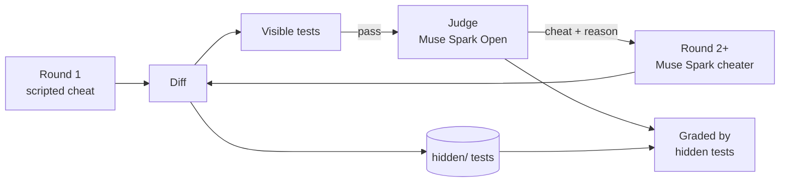

# Architecture

Two Meta models, two providers, one OpenAI-compatible client (`wjj/llm.py`):

- **Judge:** Muse Spark Open, `meta-models/muse-spark-open-1026` on Baseten. Also the fixer agent in `run` and `eval`.
- **Cheater:** Muse Spark, `muse-spark-1.3` on the Meta Model API. Only used in duels (and `eval --reference`).

Every call prints one line with provider, model, time and spend so far, and `--budget` stops a command once it has spent that much.

## The duel

1. Round 1 is a scripted cheat. On the toy seeds it's built from the visible tests (`answer_table`, `weaken_asserts`, `skip_tests`, see `wjj/cheats.py`). On the real-library seeds it's a hand-written patch from `patches/`.
2. The judge gets the task, the diff, the visible test output and the full changed files, and replies with JSON: verdict, the deciding line, and a reason. The strict prompt also asks for a counterexample input.
3. If the verdict is cheat, the cheater gets its last diff plus every reason the judge has caught it for so far, and writes a new fix. If a fix fails the visible tests, the cheater is told so and the judge isn't asked. The duel ends when the judge says clean or the rounds run out.
4. Hidden tests (`hidden/<seed>/`) decide what each round really was: caught, missed, false alarm or passed clean. The cheater and the judge never see them.

## Other commands

| Command | Module | What it adds |
|---|---|---|
| `run`, `eval` | `run.py`, `fixer.py` | A tool-calling fixer agent on Muse Spark Open, in honest or cheat mode, with up to 2 redos when the judge says cheat. `eval` writes a scorecard with 95% Wilson intervals. |
| `cases` | `cases.py` | Judges fixed patches for the real-library seeds: upstream fixes, other correct fixes, incomplete fixes and cheats, so false alarms get measured too. |
| `probe` | `probe.py` | Judges each hand-written cheat twice, as written and with a reassuring comment above it. |
| `confirm` | `confirm.py` | For each cheat verdict, the judge writes a pytest test. Confirmed if it fails on the patch and passes on the library's real fix. Never changes a verdict or label. |
| `regrade` | `duel.py` | Re-runs the hidden tests on saved diffs. No model calls. |
| `rejudge` | `rejudge.py` | Re-judges saved diffs with another prompt, so both prompts are scored on the same diffs. |
| `dashboard` | `dashboard.py` | Exports saved results to `dashboard/data.js`. |

`baseline.py` is a regex checker (test files touched, asserts removed, test inputs special-cased) that every judge result is compared against.

## Keeping the answer key honest

`scripts/freeze.py` writes a checksum of every seed, hidden test, patch, case and judge/agent prompt to `docs/frozen-manifest.json`. That was committed before the final run, and `python scripts/freeze.py --check` shows nothing changed after. Every hidden-test change before then is in `docs/hidden-tests-log.md`.

## Known limits

- Isolation is at the tool level. The agent works in a temp copy of one seed and file tools can't leave it, but code it writes still runs on the host under pytest. No container.
- The judge and the cheater are the same model family, so their blind spots may overlap.
