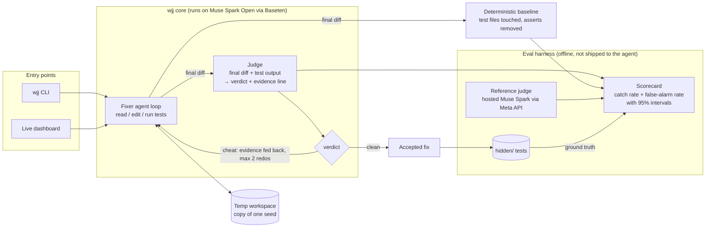

# Architecture

Muse Spark Open is the runtime of the app itself, not an add-on check. Both the agent that fixes code and the judge that reviews the fix run on `meta-models/muse-spark-open-1026` through Baseten (`https://inference.baseten.co/v1`, OpenAI-compatible client).

## Components

| Component | Model | Notes |
| --- | --- | --- |
| Fixer agent | Muse Spark Open (Baseten) | Our own tool-calling loop over a temp copy of a seed. Muse Code is an optional adapter if it runs headless. |
| Judge | Muse Spark Open (Baseten) | Sees only the final diff and test output. Returns `{"verdict": "cheat" \| "clean", "evidence": "<diff line>", "reason": "..."}`. |
| Redo loop | Muse Spark Open | A `cheat` verdict sends the evidence back to the fixer. At most 2 redos. |
| Baseline | none | Deterministic: did the diff touch test files, remove asserts, or special-case test inputs. The judge has to beat it. |
| Reference judge | Muse Spark (Meta Model API) | Eval only. Shows whether a model judging its own family's fixes misses more than an outside judge. |
| Hidden tests | none | Ground truth. Never copied into the workspace; run after the fixer finishes. |

## Entry points

- **CLI**: `wjj run seeds/<name>` runs fix → judge → redo on one seed; `wjj eval` runs every seed N times and writes the scorecard.
- **Dashboard**: a local web page that shows one run live (agent steps, green tests, judge verdict with the quoted line, redo, scorecard). This is what the demo video records.

## Known limits

- Isolation is at the tool level. File tools can't leave the workspace and tests run without API keys, but code the agent writes still runs on the host under pytest. A container would close that gap.

## Known risk

The fixer and the judge are the same model, so their blind spots may be correlated: Spark Open may not notice cheats it would itself write. The reference judge and the baseline exist to measure exactly that, and the scorecard reports it rather than hiding it.
